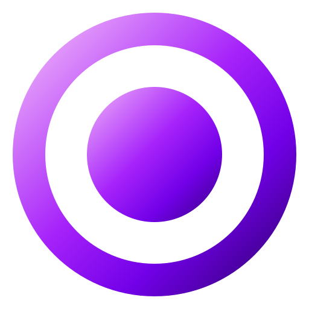

<p align="center"></p>

# Dia

**Dia** is a personal AI assistant that orchestrates coding agents — Claude Code,
OpenAI Codex, Cursor Agent, or any other CLI — across your repositories.

You describe a task; Dia gives it to an agent inside an isolated git worktree,
commits the result on its own branch, runs your tests and reports back.
Nothing is merged into your code without you.

Dia is built to be **vendor- and project-agnostic**: agents, repositories,
forges, toolchains and chat and voice interfaces are plugins chosen in
a config file. It works with subscription-logged CLIs, so no API keys are
required.

> Status: **0.1.2** (timestamps, CLI commands, About, layout): see [CHANGELOG.md](CHANGELOG.md) for what it does and
> [docs/ROADMAP.md](docs/ROADMAP.md) for what is next. Architecture:
> [docs/ARCHITECTURE.md](docs/ARCHITECTURE.md).

## Install

```bash
# Linux, macOS: no root, everything in your home
curl -fsSL https://github.com/Solar9/Dia/releases/latest/download/install.sh | sh
```

```powershell
# Windows (PowerShell)
irm https://github.com/Solar9/Dia/releases/latest/download/install.ps1 | iex
```

Arch Linux: `makepkg -si` with the `PKGBUILD` from the release. From a
checkout: `./scripts/install.sh`.

The installer ends with `dia setup`, which finds your coding CLIs, your git
repositories, an Obsidian vault and Ollama, writes the configuration, and
puts Dia's icon in the app menu and on the desktop. Click it (or run `dia
up`): everything Dia needs starts and its window opens. `dia version` shows
which Dia you have. The phone app: [docs/MOBILE.md](docs/MOBILE.md).

## Quick start (by hand, for development)

```bash
pip install -e '.[dev]'
cp dia.example.toml dia.toml      # then edit agents and projects
dia doctor                        # are the agents installed and projects valid?
dia run myproject "Add input validation to the login form"
dia run myproject "Where is the save system implemented?" --read-only -a codex
dia tasks                         # history
dia diff <task-id>                # review an edit task's changes
dia merge <task-id>               # ...and merge its branch locally, or
dia publish <task-id>             # ...push it and open a GitHub PR / GitLab MR, or
dia discard <task-id>             # ...throw it away
```

## GitHub, GitLab or any git server

`dia publish <task-id>` (or the **PR / MR** button in Discord) pushes the task
branch and opens a pull request (GitHub, via `gh`) or merge request (GitLab,
via `glab`, or GitLab's push options when `glab` isn't installed). The forge
is detected from the `origin` URL; anything else gets a plain `git push`.
Authentication stays with git, `gh` and `glab`: Dia stores no tokens.

While `dia serve` runs it watches the CI of published tasks and tells you the
result on Discord (with a **Fix CI** button) or by voice. A fix hands the
failed jobs' log to the agent that wrote the code and pushes its fix to the
same branch, so the PR/MR updates itself; `[ci] autofix = true` does that
without asking. From the terminal: `dia ci <task-id> --watch --fix`.
Review comments on the PR/MR come back the same way: Dia shows them and the
author agent addresses them (`dia comments <task-id> --fix`, or a button).

`dia service install` runs all of this as a systemd user service from login.

## Plans: several agents, one goal

```bash
dia plan nova "Add a crafting system with UI and tests"     # a planner agent proposes steps
dia plan nova "Add crafting" --pipeline feature             # or use a recipe from the config
```

Steps run one after another on one branch, each agent seeing what the earlier
ones did (e.g. Claude designs, Codex implements, Cursor builds the UI). You
confirm the plan before it starts (Discord: `/plan` with a **Run plan**
button; by voice or `dia say`, a request for a bigger piece of work becomes a
plan). The result is one task: review, merge, PR/MR and CI work as usual.

## Godot

Godot 4 projects are recognised from `project.godot`. Agents are told the
Godot version, main scene and the rules that keep scenes valid; changes are
tested headless (import, then GUT or gdUnit4 when present, else a short run
of the main scene), and script errors fail the task even when Godot exits
cleanly. `dia launch nova` (or "Jarvis, odpal Nova") starts the game. Other
engines and stacks can be added as `dia.toolchains` plugins.

## Cross-review

```bash
dia run myproject "Add a save system" -a codex --review   # Claude (or any other agent) reviews
dia review <task-id> -a cursor                             # review an existing task
```

The reviewer gets the diff and answers with a verdict. When it requests
changes, the author agent addresses them, tests rerun and the reviewer looks
again (`[review] fix_rounds`). Set `[review] auto = true` to review every task.

## Talk to it

```bash
dia say "dodaj w nova sterowanie padem, strzelanie pod prawym spustem"
dia say --dry-run "what does the save system in starfall do?"   # just show the plan
```

A **brain** decides what you meant: fixed phrases are matched for free, the
rest goes to the brain chain you configure: a local model (Ollama, LM Studio,
llama.cpp...), Claude, Codex or Cursor, with fallback between them.

## Desktop app and KDE widget

`dia app` opens Dia in its own window: tasks with live progress, diffs and
review buttons, a chat, status, settings with themes, and a voice button.
`dia plasmoid install` adds a Plasma panel widget. Details: [docs/UI.md](docs/UI.md).

## On your phone

The same UI installs as an app on Android and iOS. Pair the phone with
`dia mobile pair` (QR code), reach the computer privately over Tailscale.
Setup: [docs/MOBILE.md](docs/MOBILE.md).

## An assistant, not only an orchestrator

Weather, news, markets and a daily briefing; a schedule ("every weekday at
7:30 give me the briefing", said aloud); a personality and the name Dia
calls you by; an ElevenLabs voice if you like; push notifications on your
phone; a local Ollama brain; all configurable in the app.
Details: [docs/ASSISTANT.md](docs/ASSISTANT.md). Where Dia is going:
[docs/ROADMAP.md](docs/ROADMAP.md).

## Missions and control

Give Dia a goal ("przygotuj Nova do testów") and it plans a graph of steps,
runs independent ones in parallel on their own branches, integrates and
tests the result, and waits for your Merge. Budgets, Mission Control, a
red emergency Stop everywhere, an audit log of who did what, quiet mode and
a memory browser. Details: [docs/MISSIONS.md](docs/MISSIONS.md).

## Your computer and your games

"Jak tam komputer?", alerts on heat, full disks or a server that stopped
answering, "zamknij godota" (after your yes), failed services and pending
updates (reported, never installed), an opt-in look at your screen, and
Godot builds with changelogs. Details: [docs/COMPUTER.md](docs/COMPUTER.md).

## Security and integrations

A security report of your computer and projects (open ports, failed logins,
vulnerable dependencies; scans only of your own hosts), your calendar and
mail (read-only), Home Assistant, and itch.io publishing on your click.
Details: [docs/SECURITY.md](docs/SECURITY.md), [docs/INTEGRATIONS.md](docs/INTEGRATIONS.md).

## Voice and beyond

"Hej Dia" without training a model (and "Hej Dia, jaka pogoda?" in one
breath), answers that start at once and stop when you press the shortcut,
an AI Council (`dia council`: several agents answer, a moderator weighs
them), and per-project agent ratings with proposals you can apply.

## Learning, recovering, recognising

Dia keeps your preferences ("zapamiętaj, że wolę krótkie odpowiedzi") and
how-tos written from finished tasks, both on your approval; retries a failed
step or lets the author fix failing tests (`[retry]`); answers "czy parry
działa?" by having a test written and run; looks for new devices on your
own networks; publishes builds to Steam; reads and adds Notion notes; takes
a single camera photo when you switch the camera on; and knows who is
speaking.

## Everyday care

Quiet hours and a daily notification budget (held notifications come as one
summary), rolling back a merged task as a tested revert, tidying Downloads
with a preview and undo, the clipboard on request, a Godot scene and
performance analysis, and web research reports with sources.

## Agents in a sandbox

Agents work in a bubblewrap sandbox: they see their worktree and tools, not
your SSH keys, secrets, other projects or Dia's data; decoy secrets catch an
agent that goes looking, and `dia redteam` tests it all against hostile
instructions. See [docs/SECURITY.md](docs/SECURITY.md).

## Experiments and measurement

A project's benchmark (`benchmark = "..."`) runs after every merge and
reports a regression with the commits that came in; `dia bench nova` runs it
by hand. `dia experiment nova "inventory as ECS: faster?" --approach ECS
--approach "cache lookups"` tries a change several ways and recommends the
variant with the best numbers. `dia scorecard` shows Dia's own results week
by week, agents are judged by quality (rollbacks, regressions, review
rounds) and `dia brains --replay` tries a new brain on your real requests
without executing anything. See [docs/MEASUREMENT.md](docs/MEASUREMENT.md).

## A memory of decisions

Dia keeps every merge, discard, rollback and rejected plan with your reason,
so `dia why "dlaczego zrezygnowaliśmy z ECS?"` finds the decision and what
came of it. From those decisions it drafts your working-style profile for
the agents (you approve and edit it), checks the project notes against the
code (`dia contradictions`) and answers "co się może zepsuć, jeśli zmienię
dash?" from the scene and script graph, git history and tests (`dia
impact`). See [docs/DECISIONS.md](docs/DECISIONS.md).

## Quality guards

Architecture rules (`ARCHITECTURE.md`, forbidden dependencies) are checked on
every change and by the reviewer; after a large change the agent's
assumptions are checked by commands Dia runs. Either blocks merging until
you override it with a reason. `dia debt` ranks technical debt and pays it
off as tasks, and `dia debug` sends a bug to several agents whose
hypotheses are settled by tests. See [docs/QUALITY.md](docs/QUALITY.md).

## Goals and context

Goals over weeks ("Starfall do Early Access") are broken into
milestones, reviewed weekly and moved forward one approved mission at a
time; every plan shows its likely files, cost and risks before it runs.
"Zaczynam pracę nad Starfall" opens your apps and tells you where you
left off, your conversation with Dia follows you across devices, Dia
suggests things only from its own history (a few a day, within quiet
hours), and `dia serve` keeps itself running (`dia doctor --fix` repairs
the rest). See [docs/GOALS.md](docs/GOALS.md).

## Guard rails and game balance

Limits per task (agent minutes and calls, a call timeout, lower CPU
priority), routing that picks the agent for a task by your rules or the
agents' record, and a balance report from playtest telemetry (`dia balance`).

## Usage limits, watching, learning

- When an agent runs out of its plan's limit, Dia hands the work to another
  agent or waits for the reset (`dia limits`; `[limits]`).
- `[watch]` tests every new commit of your projects and, when one breaks the
  tests, offers a one-click fix by an agent (`dia check`, `dia fix-build`).
- `[memory] learn` proposes facts worth keeping in the project note after a
  task; nothing is written until you accept (`dia learned`, `dia remember`).
- Issues labelled `dia` become plans waiting for your approval (`[issues]`).
- The Usage view shows calls, time and limits per agent (`dia usage`).

## Voice

Bind `dia voice toggle` to a shortcut in your desktop's settings (KDE, GNOME,
Xfce, Hyprland, Sway... on Wayland or X11), press it, speak, press again: Dia
transcribes locally with Whisper, acts, and answers with a local Piper voice.
Optionally hands-free with a wake word ("Hej Dia" via whisper-keyword without
training, or a trained openWakeWord model).
Setup: [docs/VOICE.md](docs/VOICE.md).

## Discord

`dia serve` runs a Discord bot: give tasks with `/run` and `/ask` (or just
write to it in a DM or @mention it), get pinged
when they finish, and approve changes with **Diff / Merge / Discard**
buttons from your phone. Setup: [docs/DISCORD.md](docs/DISCORD.md).

## Memory (optional)

Point Dia at a folder of Markdown notes, e.g. an Obsidian vault, and every
task gets your profile and the project's notes as context, while a daily
journal records what the agents did:

```toml
[memory]
type = "obsidian"
vault = "~/Obsidian/MyVault"   # Dia only writes to <vault>/Dia/
search = "vault"               # also pull related excerpts from any note...
exclude = ["Private"]          # ...except these (and notes marked `dia: private`)
```

`dia memory search "inventory system"` shows what an agent would receive.

## Supported agents

| Plugin        | Drives                    | Notes                                   |
|---------------|---------------------------|-----------------------------------------|
| `claude-code` | `claude -p`               | Claude subscription or API key          |
| `codex`       | `codex exec`              | ChatGPT plan or OpenAI API key          |
| `cursor`      | `agent -p` / `cursor-agent -p` | Cursor plan (binary auto-detected) |
| `command`     | any CLI, from config only | aider, local-model wrappers, scripts... |

Adding a new agent is one small class; see
[docs/ARCHITECTURE.md](docs/ARCHITECTURE.md#writing-a-plugin).

## Development

```bash
pip install -e '.[dev]'
pytest
ruff check . && ruff format --check .
```

## License

Dia is source-available under the [PolyForm Noncommercial License 1.0.0](LICENSE):
you may use, study and change it for noncommercial purposes. It is not an
OSI-approved open-source license.

### Commercial license

Any commercial use (paid work, use inside a business, selling it, paid or
hosted services) needs a separate license from the author. Solo starts at
99 USD/year, larger deployments by arrangement, see
[COMMERCIAL-LICENSE.md](COMMERCIAL-LICENSE.md).

**FAQ**

- *Can I use Dia for free?* Yes, for personal, hobby, research and educational
  use.
- *Can I use it for my job or freelance work?* That is commercial use and
  needs a Solo (or larger) license.
- *Can I use it inside my company?* Yes, with a Team, Business or Company
  license.
- *Can I build or host a paid service on top of it?* Contact the author for an
  OEM / hosting license.
- *Can I contribute?* Yes, under the CLA in [CONTRIBUTING.md](CONTRIBUTING.md).

### Contributing

Contributions are welcome and require agreeing to a short CLA, see
[CONTRIBUTING.md](CONTRIBUTING.md).
